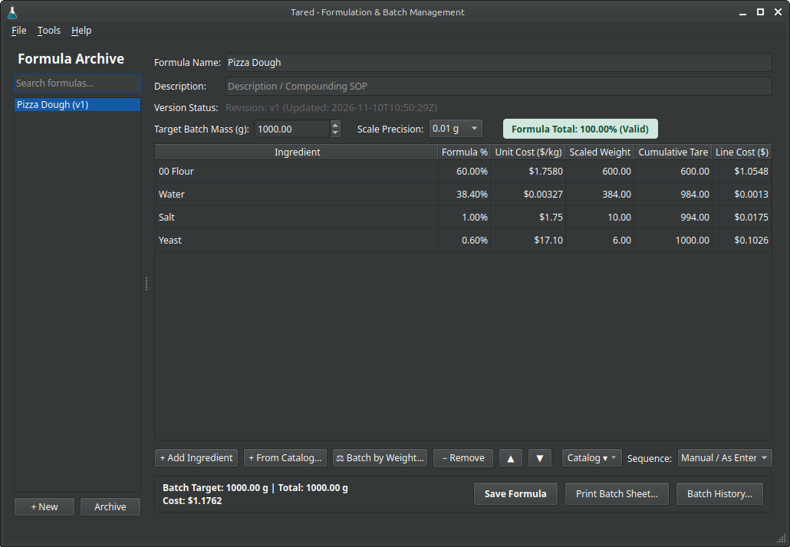

<p align="center">
  
</p>

# Tared

### Desktop formulation and batch compounding suite.

A desktop formulation suite and production scaling manager built with **Python 3.11+**, **PyQt6**, and **SQLite**. Packageable as a standalone Linux **AppImage**.

<p align="center">
  
</p>

> **Important Regulatory Notice:** Tared is an engineering calculation, compounding preparation, and record-keeping tool. It is **not** a validated electronic records system under FDA 21 CFR Part 11, EU Annex 11, or cGMP compounding frameworks. It does not provide cryptographic user authentication, tamper-evident audit hardware, or multi-party electronic signatures. Batch execution sheets must be reviewed and verified by qualified personnel against your facility's Standard Operating Procedures (SOPs).

---

## Key Features

- **Conservation of Mass Invariant:** Scaled ingredient weights are computed in high-precision `decimal.Decimal` context using normalized proportional distribution and Hare-Niemeyer (largest remainder) allocation. Allocated discrete units always equal target mass units down to the scale quantum.
- **Scale-Precision Aware:** Supports 0.001 g, 0.01 g, 0.1 g, and 1 g. Target batch masses must be exact multiples of the precision quantum. The calculation engine detects trace components that round to 0 mass or deviate by >25% due to scale quantization.
- **Cumulative Tare Weighing:** Batch sheets and live grids display running cumulative vessel tares. Compounding operators add each ingredient directly into a single mixing vessel without re-taring the scale.
- **Master Raw Materials Catalog:** Centralized raw material price book (`ingredients_catalog`) with inline autocompletion in ingredient cells, automatic price population, supplier and SKU tracking, and non-destructive two-way price learning.
- **Immutable Revision Snapshots:** Edits that change formula name, description, ingredient sequence, percentages, or unit costs increment the recipe version and trigger an immutable snapshot in `recipe_revisions` enforced by SQLite database triggers.
- **Production Batch Logging & PDF Export:** Exporting a batch sheet generates a print-ready PDF and logs the batch run into the `batches` table referencing the immutable recipe revision. Past batches can be reprinted from **Batch History...** with historical fidelity.
- **Failsafe Disaster Recovery:** In-progress formula drafts (<100%) can be saved with confirmation. Automated workspace backups (`tared_workspace.json`) rotate up to 3 generations and can be targeted to cloud sync folders (Nextcloud, Dropbox, Syncthing).
- **Verified AppImage Self-Updating:** Integrated release checking directly queries upstream GitHub Releases, enforces fail-closed SHA-256 digest matching, and atomically swaps running AppImage binaries in place.

---

## Technical Specifications & Mathematical Model

### 1. Calculation & Discrete Quantization Engine
When scaling a formula to a target mass $M$ at scale precision $Q$:
1. **Total Percentage Normalization:** Formula percentages are summed: $S = \sum p_i$. Percentages must sum to 100.00% ($\pm 0.0001\%$) for production batch generation.
2. **Exact Mass Proportions:** Unrounded target weight for ingredient $i$ is $w_i = (M \times p_i) / S$.
3. **Discrete Hare-Niemeyer Floor Units:** $u_i = \lfloor w_i / Q \rfloor$.
4. **Remainder Resolution:** Remainder $r_i = w_i - (u_i \times Q)$.
5. **Deficit Allocation:** Total units required is $U = M / Q$. The unit deficit $D = U - \sum u_i$ is distributed one unit at a time to ingredients prioritized by:
   - Highest remainder $r_i$.
   - Highest formula percentage $p_i$ (tie-breaker 1).
   - Earliest formula index (tie-breaker 2).
6. **Cost Valuation:** Unit costs are denominated in $/kg. Line and batch costs are calculated directly from raw scaled grams: $\text{Cost} = (w_{\text{scaled}} \times \text{Cost}_{\text{per kg}}) / 1000$. Line items display adaptive precision (2 or 4 decimal places), while total cost is rounded from unrounded sum accumulation to prevent rounding drift.

### 2. Draft Lifecycle & Revision Archival Semantics
- **Immutable Revision Progression:** Under Tared's audit model, calling **Save Formula** on any recipe that alters formula name, compounding instructions, ingredient order, percentages, or unit costs generates an immutable snapshot in `recipe_revisions` and increments the recipe version ($v1 	o v2 	o v3$).
- **In-Progress Drafts:** Formulations that do not yet sum to 100.00% may be saved as drafts with user confirmation. Each save event records an immutable revision snapshot, ensuring work-in-progress can be audited or restored from workspace backups.
- **Production Gate:** Batch sheet printing and PDF generation remain strictly locked until formula percentages sum to 100.00% ($\pm 0.0001\%$).

### 3. Operational Considerations & System Limits
- **Units of Measure:** Batch masses are strictly denominated in grams (g) and raw material unit costs in currency per kilogram ($/kg).
- **Physical Print Layout:** Batch sheet templates are pre-scaled for standard **A4 portrait** dimensions (210 × 297 mm with 10 mm margins). Printers using US Letter or alternate page sizes should configure printer driver scaling.
- **Single-User Architecture:** Storage uses local SQLite with Write-Ahead Logging (WAL). The database is optimized for local single-process compounding execution and must not be hosted concurrently across networked shared folders (such as NFS or SMB) where SQLite locking locks can fail.
- **Linux Runtime Requirements:** Packaging relies on standard Type-2 AppImage bundles requiring `libfuse2` on distributions such as Ubuntu 22.04+ and Debian 12+:
  ```bash
  sudo apt-get install libfuse2
  ```
- **Workspace Reset Safeguard:** The **Danger Zone: Reset Workspace** feature clears tables back to an empty slate, but automatically exports both a full JSON snapshot (`recipes_pre_reset_*.json`) and a SQLite database copy (`recipes_pre_reset_*.bak`) beforehand, requiring typing `"RESET"` to confirm.

---

## Installation

### Requirements
- Linux (x86_64, aarch64)
- Python 3.11 or newer
- PyQt6 6.5+ (Qt libraries: `libgl1`, `libxkbcommon0`, `libegl1`, `libdbus-1-3`)

### Development Setup
```bash
python3 -m venv .venv
source .venv/bin/activate
pip install --upgrade pip
pip install -e ".[dev]"
```

### Running Tests and Linter
```bash
# Run unit and integration test suite
QT_QPA_PLATFORM=offscreen python3 -m unittest discover -s tests -p "test_*.py"

# Run linting check
pipx run ruff check .
```

### Packaging AppImage
```bash
./scripts/build_appimage.sh
```

---

## File Storage Paths

| Data Artifact | Standard Linux Filesystem Location |
|---|---|
| Formulation Database | `~/.local/share/tared/recipes.db` |
| Application Crash Logs | `~/.local/share/tared/tared_crash.log` |
| Automated Cloud Backup | Configurable in Settings / `tared_workspace.json` |
| Legacy Database (Auto-migrated) | `~/.local/share/recipe_studio/recipes.db` |

---

## License

Tared is free software licensed under the **GNU General Public License v3.0 or later (GPL-3.0-or-later)**.
